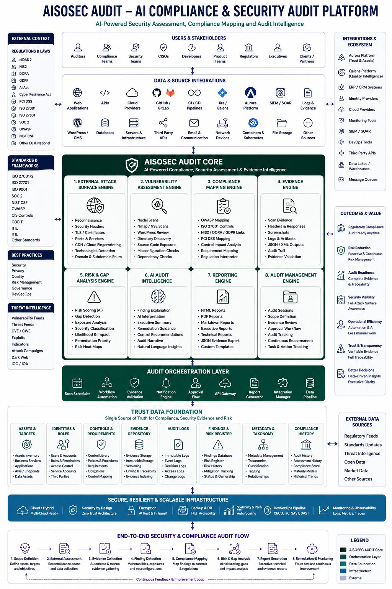

# AisoSec Audit

## Architecture Vision

AisoSec Audit is evolving from a security assessment tool into an AI Compliance & Security Audit Platform focused on evidence, risk analysis, compliance mapping, audit-ready reporting and continuous trust infrastructure.

AisoSec Audit is a macOS-friendly security assessment and reporting tool focused on authorized external web security reviews.

It helps identify public-facing exposure, weak configurations, security headers, exposed assets, source code patterns, and technical findings that can be transformed into clear audit-ready reports.

## Documentation

- [AisoSec Control Library](docs/CONTROL_LIBRARY.md)

## Current capabilities

- General information and enumeration
- Security header review
- TLS and certificate inspection
- Nmap-based port scanning
- Nuclei-based vulnerability scanning
- Subdomain and directory discovery
- Site spidering and mapping
- Source code exposure analysis
- API security testing
- WordPress review
- HTML, Markdown, JSON and TXT reports

## Vision

AisoSec Audit is evolving from a security scanner into an AI Compliance & Security Audit Platform.

The long-term direction includes:

- Evidence collection
- Compliance mapping
- Risk and gap analysis
- Audit management
- AI-generated executive summaries
- Professional remediation reports
- Integration with Aurora Trust Engine and Qalens

## Responsible use

AisoSec Audit must only be used against systems you own or have explicit permission to assess.

Unauthorized scanning, exploitation, brute force, or intrusive testing is not acceptable.

## Attribution

AisoSec Audit started from an open-source WSTG scanning foundation and is being customized into a broader compliance, evidence and audit platform.

Technical references such as OWASP, WSTG, Nuclei, Nmap, CVE and related standards are preserved where relevant.
